<div align="center">

# 👁️ Íris

**Agenda inteligente para a recepção de clínicas de oftalmologia**


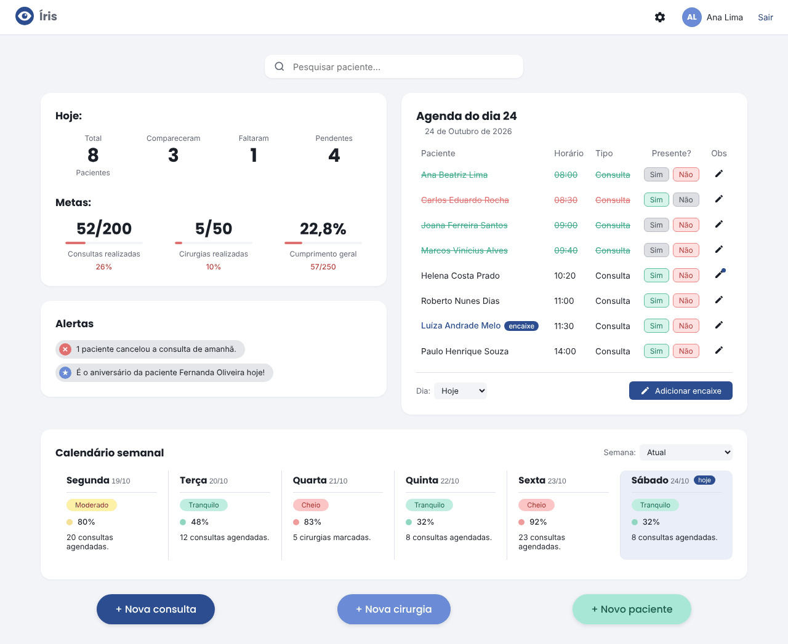

</div>

---

## 💡 Sobre

Projeto de estudo que nasceu de um problema real: ajudar a minha mãe, que é secretária em um consultório de oftalmologia, a organizar o dia a dia da recepção. Ela precisa cadastrar pacientes, marcar consultas e cirurgias, controlar quem compareceu e não estourar o limite de atendimentos do dia — tudo isso, hoje, com muita coisa feita à mão.

O Íris reúne tudo em uma tela: a agenda do dia com a presença de cada paciente, o calendário da semana colorido pela ocupação, as metas do mês e os alertas do dia.

> ⚠️ Projeto acadêmico e pessoal, **sem vínculo oficial** com nenhuma clínica ou hospital. Nenhum dado real de paciente é usado — todos os nomes nas imagens são fictícios.

---

## ✨ Funcionalidades

**Painel**
- 📅 **Agenda do dia** — presença com um clique (✅ compareceu / ❌ faltou), observação por atendimento e destaque para encaixes
- 📊 **Resumo "Hoje"** — total, compareceram, faltaram e pendentes, atualizado na hora
- 🎯 **Metas do mês** — consultas e cirurgias realizadas e o **cumprimento geral** (realizado ÷ meta), com cores por desempenho
- 🔔 **Alertas** — cancelamentos de amanhã, cirurgias sem confirmação e aniversariantes do dia
- 📆 **Calendário semanal** — ocupação de cada dia: 🟢 tranquilo · 🟡 moderado · 🔴 cheio; clicar no dia abre a agenda dele

**Pacientes**
- 👥 **Cadastro** com máscaras de CPF e celular e validações (CPF único, e-mail, plano "Outros")
- 🔎 **Busca** por nome ou CPF enquanto digita, com atendimentos realizados, último e próximo
- 📋 **Ficha** com edição dos dados e histórico de atendimentos colorido por situação

**Agendamentos**
- 🩺 **Nova consulta**, 👁️ **nova cirurgia** e ⚡ **encaixe**, no fluxo "o paciente possui cadastro?" → busca → formulário
- 🕐 **Horários livres** calculados pelo sistema (consultas de 10 em 10 minutos, cirurgias em horas cheias)
- 🔄 **Remarcar** e ❌ **cancelar** pela ficha — o atendimento antigo fica marcado como "remarcado" e ligado ao novo

**Conta**
- 🔐 **Login** com "lembre-se de mim"
- 🙋 **Perfil** com foto, dados e troca de senha
- ⚙️ **Configurações** de acessibilidade: **modo escuro** (ou igual ao do computador) e **tamanho da letra**, salvos no perfil

---

## 🖥️ Telas

| | |
|---|---|
| 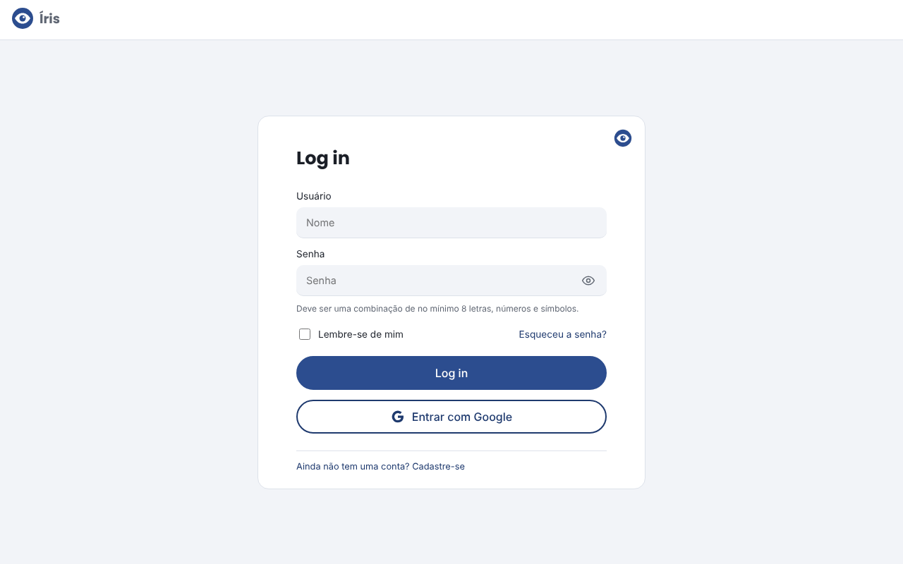 **Login** | 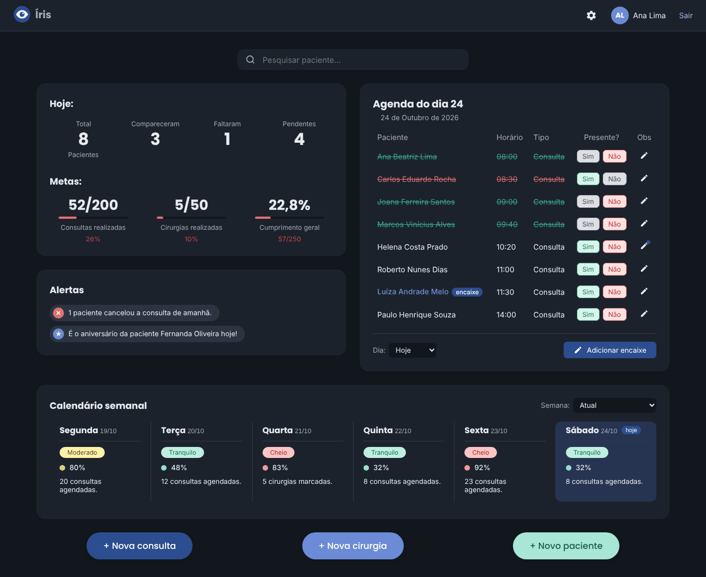 **Painel no modo escuro** |
| 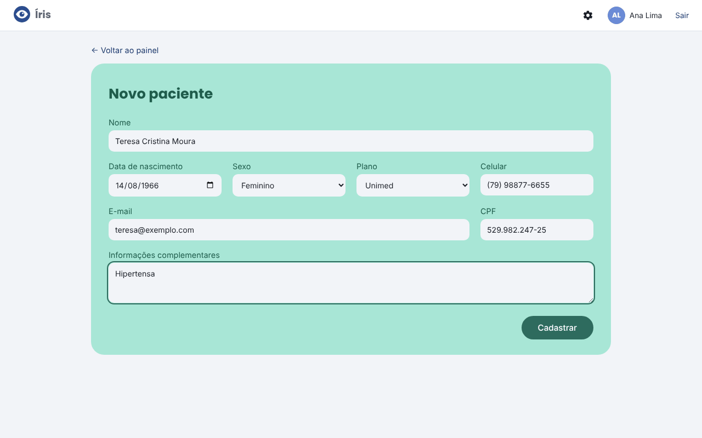 **Novo paciente** | 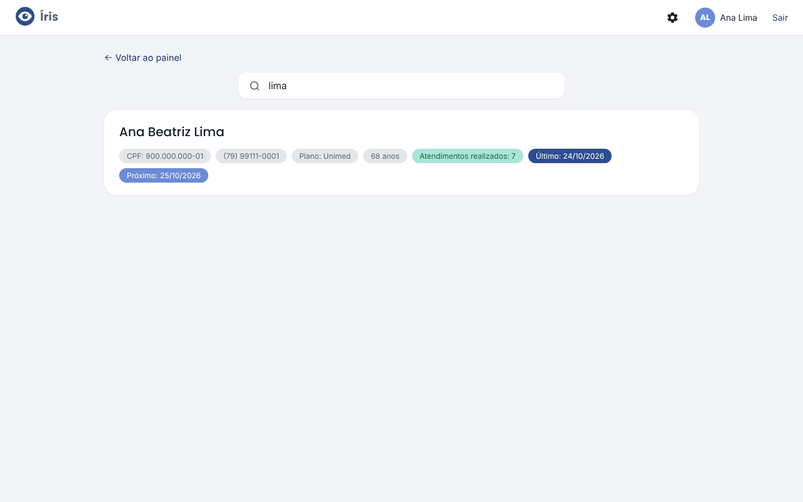 **Busca de pacientes** |
| 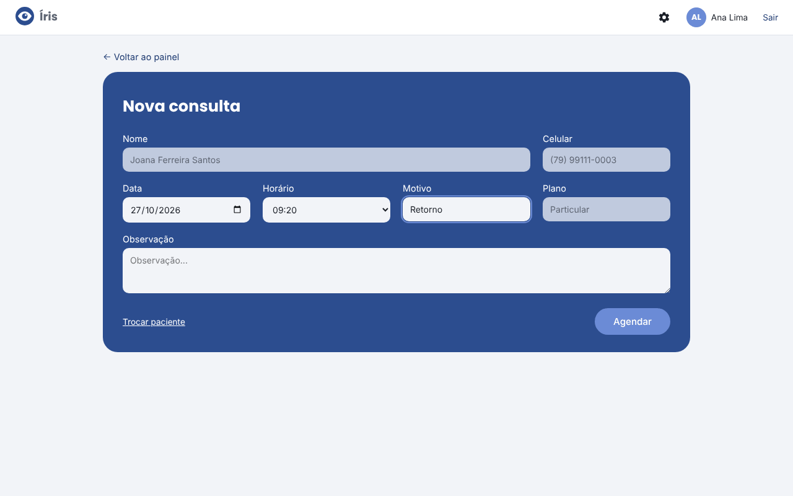 **Nova consulta** | 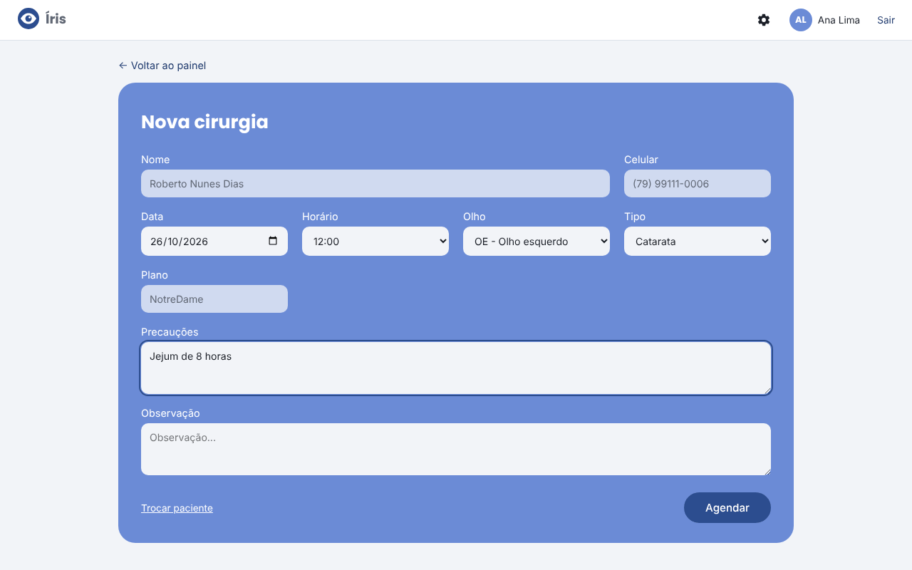 **Nova cirurgia** |
| 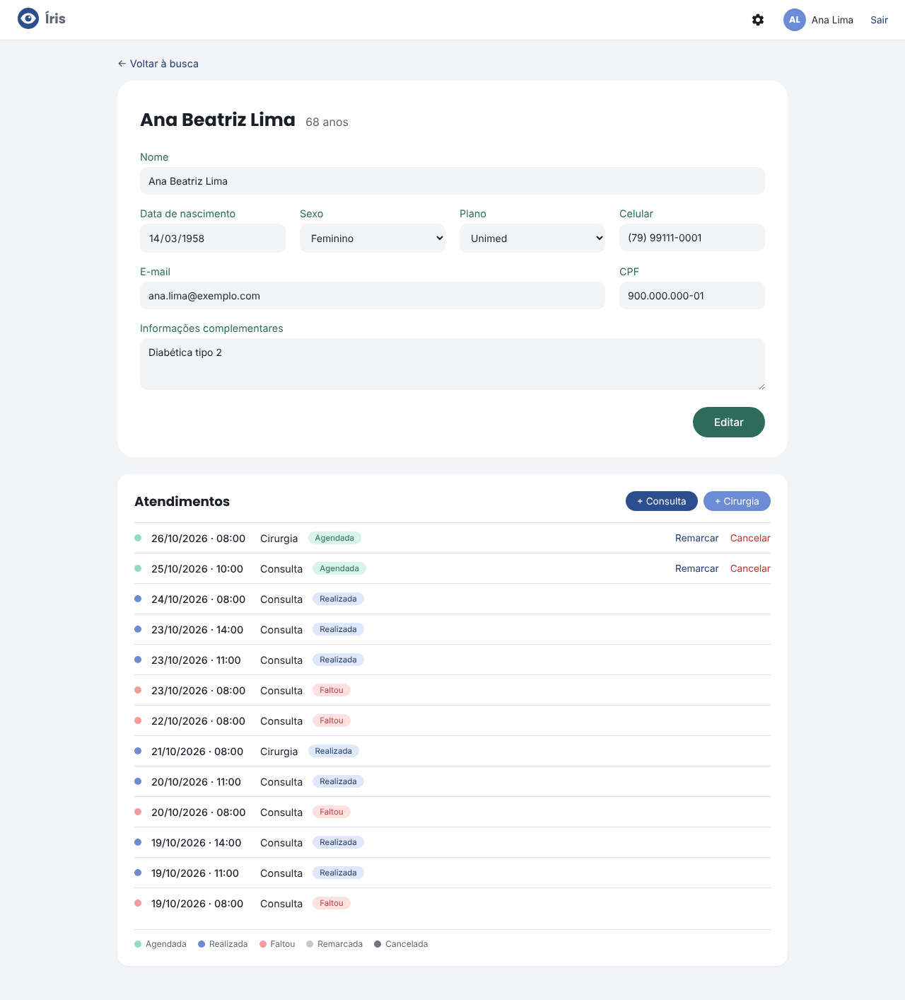 **Ficha do paciente** | 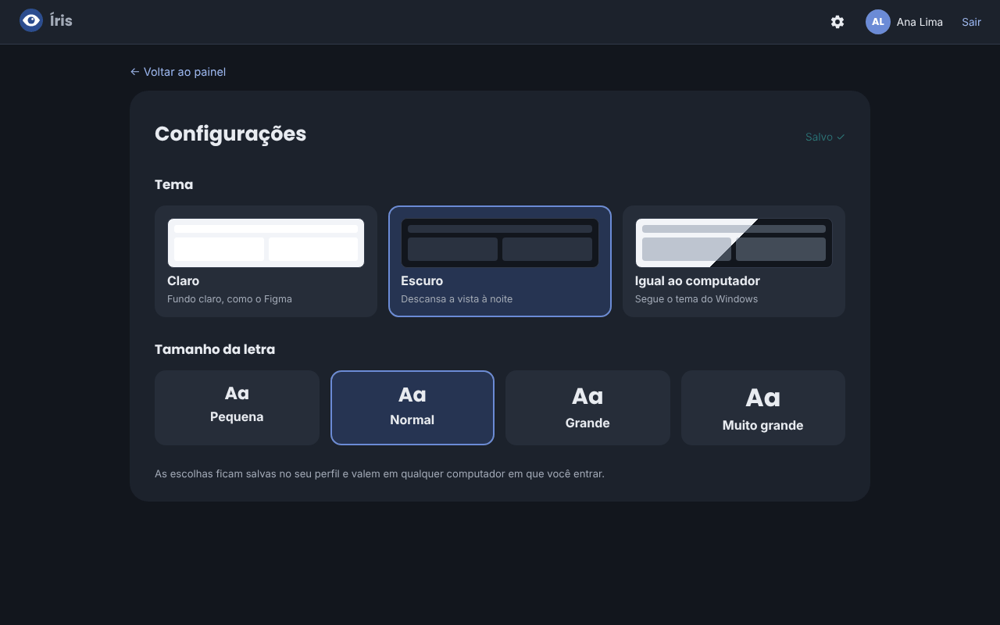 **Configurações** |

<div align="center">
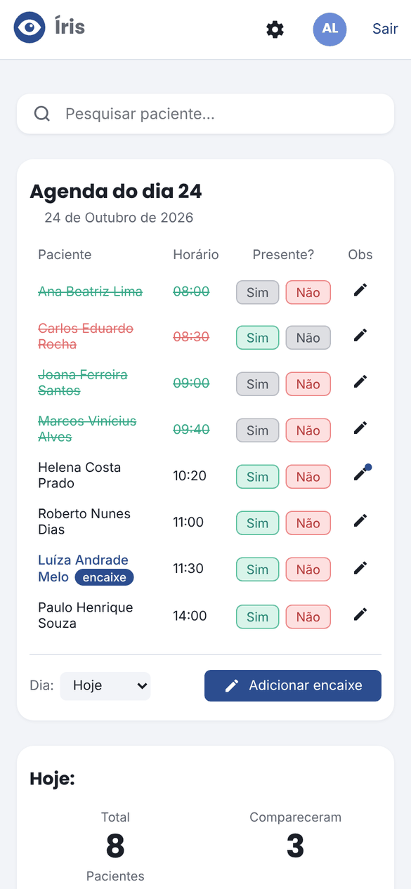
<br><sub>Também funciona no celular</sub>
</div>

---

## 📐 Regras de negócio

Todas as regras ficam no back-end (no modelo de agendamento) e são conferidas tanto ao salvar quanto ao listar os horários livres — nenhuma tela consegue furá-las.

| Regra | Como funciona |
|---|---|
| Consultas por dia | até **20** normais + **5** encaixes |
| Cirurgias por dia | até **6**, sempre em horas cheias |
| Consulta e cirurgia no mesmo dia | ❌ não permitido |
| Horário repetido | ❌ não permitido (também garantido no banco) |
| Expediente | das 08:00 às 18:00 |
| Datas que já passaram | ❌ não dá para agendar; hoje, horários passados somem da lista |
| CPF duplicado | ❌ não permitido |
| Ocupação no calendário | até 50% tranquilo · 51–80% moderado · 81% ou mais cheio |

---

## 🛠️ Tecnologias e arquitetura

| Parte | Tecnologias |
|---|---|
| **Back-end** | Python, Django, Django REST Framework, Pillow |
| **Front-end** | React, TypeScript, Vite, React Router |
| **Banco** | PostgreSQL |
| **Qualidade** | testes automatizados do Django, ESLint |

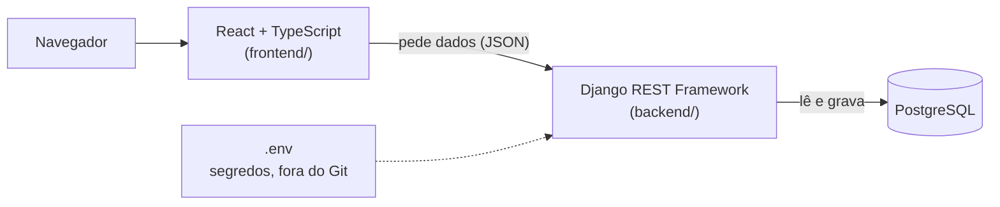

O React nunca acessa o banco diretamente: ele conversa com a **API** do Django, que aplica as regras e só então lê ou grava no PostgreSQL. Senhas e chaves ficam em um arquivo `.env` que **não vai para o GitHub** — o repositório traz apenas o modelo `.env.example`.

---

## 📁 Estrutura

```
Sistema_Hospital/
├── backend/                      # API em Django + DRF
│   ├── config/                   # configurações e rotas principais
│   ├── contas/                   # login, perfil, foto, preferências de tela
│   ├── pacientes/                # cadastro, busca e números de cada paciente
│   ├── agenda/                   # consultas, cirurgias, regras, horários livres, remarcação
│   │   └── management/commands/
│   │       └── dados_exemplo.py  # cria dados fictícios para testar
│   ├── dashboard/                # metas do mês e alertas
│   ├── manage.py
│   └── requirements.txt
│
├── frontend/                     # interface em React + TypeScript (Vite)
│   └── src/
│       ├── api/                  # comunicação com a API
│       ├── auth/                 # quem está logado (contexto de login)
│       ├── components/           # agenda, calendário, busca, formulários...
│       ├── pages/                # Login, Painel, Pacientes, Agendar, Perfil, Configurações
│       ├── types/                # tipos TypeScript
│       └── utils/                # datas, máscaras, preferências de tela
│
├── docs/telas/                   # imagens deste README
├── .env.example                  # modelo das variáveis de ambiente
└── README.md
```

---

## 🚀 Como rodar

**Pré-requisitos:** Python 3.12+, Node.js 22 (LTS) e PostgreSQL.

**1. Banco de dados** — crie um banco vazio chamado `sistema_hospital` (pelo pgAdmin ou pelo `psql`).

**2. Back-end**

```bash
git clone https://github.com/livia4526/Sistema_Hospital.git
cd Sistema_Hospital/backend

python -m venv venv
venv\Scripts\activate             # Linux/Mac: source venv/bin/activate
pip install -r requirements.txt
```

Copie o `.env.example` (na raiz) para `backend/.env` e preencha a senha do PostgreSQL e uma chave secreta, que pode ser gerada com:

```bash
python -c "from django.core.management.utils import get_random_secret_key; print(get_random_secret_key())"
```

Depois:

```bash
python manage.py migrate          # cria as tabelas
python manage.py createsuperuser  # cria seu usuário de acesso
python manage.py dados_exemplo    # (opcional) pacientes e agendamentos fictícios
python manage.py runserver        # http://localhost:8000
```

**3. Front-end** (em outro terminal)

```bash
cd frontend
npm install
npm run dev                       # http://localhost:5173
```

Abra **http://localhost:5173** e entre com o usuário criado no `createsuperuser`.

---

## 🧪 Testes

```bash
cd backend
python manage.py test
```

São **53 testes automatizados** cobrindo as regras de negócio (limites diários, horário repetido, consulta × cirurgia no mesmo dia, datas passadas), a API de pacientes e agendamentos, a remarcação (que desfaz tudo se o novo horário estiver ocupado), as metas, os alertas, o login, o perfil e o envio de foto.

---

## 🔌 API

Todos os endereços exigem login.

| Endereço | O que faz |
|---|---|
| `/api/pacientes/?search=` | lista, busca, cadastra e edita pacientes |
| `/api/agendamentos/?data=&tipo=&paciente=` | lista, marca e edita consultas e cirurgias |
| `/api/agendamentos/horarios-livres/?data=&tipo=` | horários vagos de um dia |
| `/api/agendamentos/{id}/remarcar/` | remarca um atendimento |
| `/api/agendamentos/resumo/?data=` | números do bloco "Hoje" |
| `/api/agendamentos/semana/?semana=` | ocupação de cada dia da semana |
| `/api/painel/metas/` · `/api/painel/alertas/` | metas do mês e alertas do dia |
| `/api/auth/...` | login, sessão, perfil, foto e senha |

---

## 📈 Evolução do projeto

| | v1 — onde comecei | v2 — atual |
|---|---|---|
| **Back-end** | Flask com rotas escritas à mão | Django + Django REST Framework |
| **Front-end** | HTML + CSS + JavaScript puro | React + TypeScript |
| **Banco** | SQLite (arquivo local) | PostgreSQL |
| **Login** | Implementado do zero | Autenticação do Django |
| **Regras de negócio** | Espalhadas entre as rotas | Centralizadas e cobertas por testes |

A **v1** foi feita quando eu só conhecia HTML, CSS e JavaScript: funcionou, mas o código ficou difícil de manter. Depois de aprender React, TypeScript e Django, reconstruí o sistema separando **back-end (API)** e **front-end**, com um banco de dados de verdade e as regras testadas automaticamente.

A versão original continua guardada na branch [`v1-flask`](../../tree/v1-flask).

---

## 🗺️ Roteiro

- [x] Estrutura do back-end em Django + PostgreSQL
- [x] Pacientes: cadastro, busca, ficha e edição
- [x] Agendamentos com limites diários, horários livres e testes
- [x] Login, perfil com foto e troca de senha
- [x] Painel: agenda do dia, resumo, metas, alertas e calendário semanal
- [x] Encaixe, remarcação e cancelamento
- [x] Modo escuro e tamanho da letra

---

<div align="center">

Feito com 💜 por [Lívia](https://github.com/livia4526) · Licença [Apache 2.0](LICENSE)

</div>
